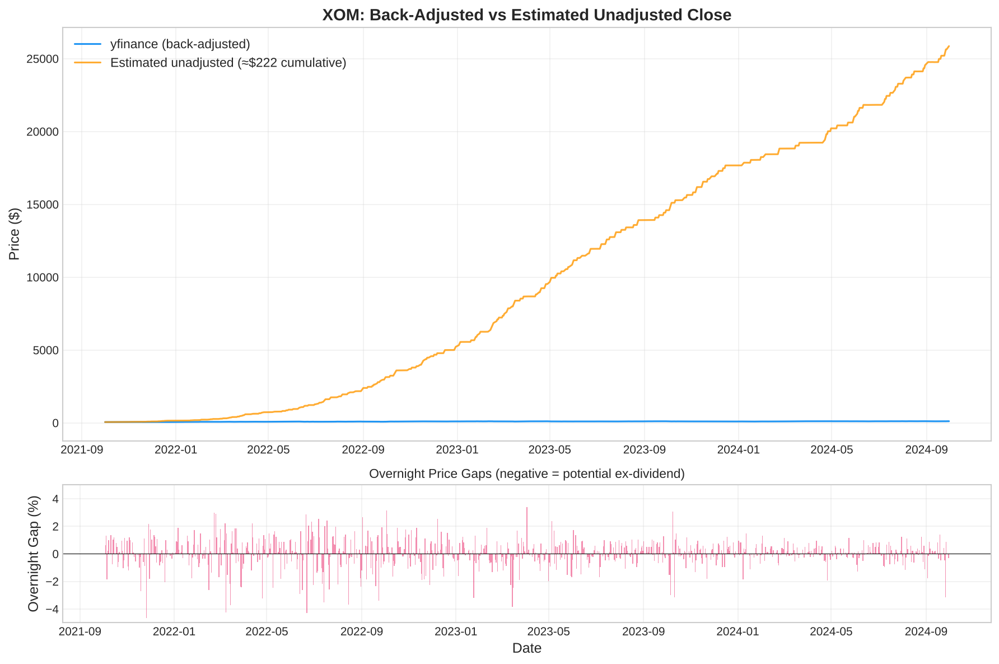
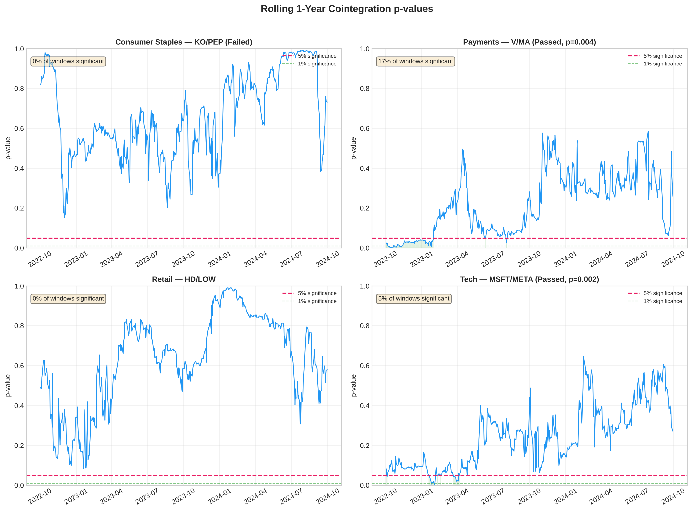
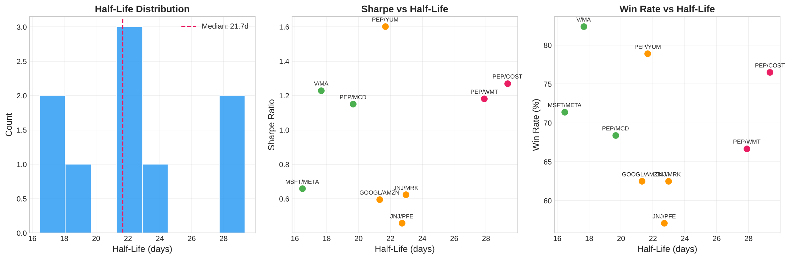
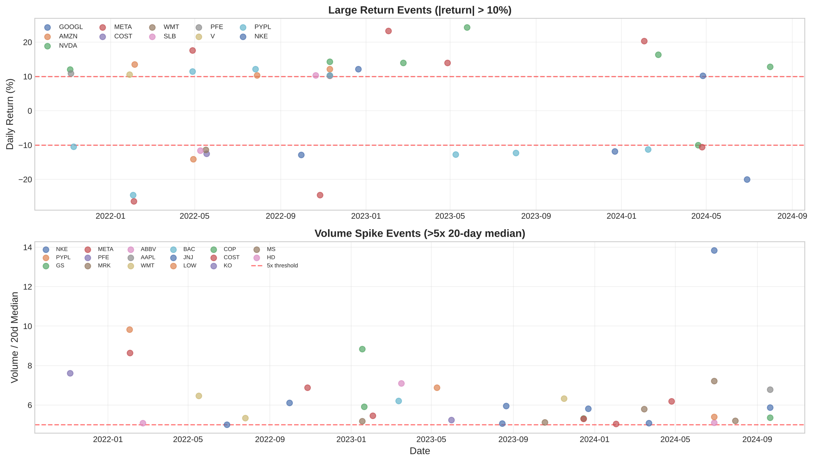
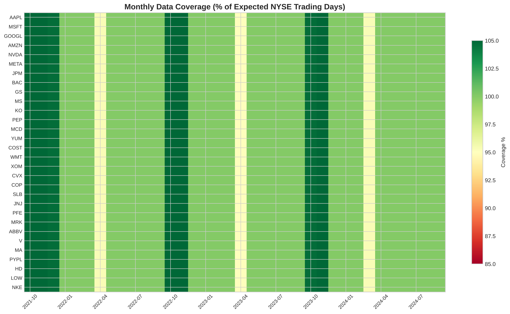

# Data Investigation Report

**Equity Pairs Trading Pipeline — Post-Build Analysis**  
*30 tickers · 753 trading days · Oct 2021 – Sep 2024*

---

## Methodology

**Universe**: 30 S&P 500 constituents across 7 sectors (tech, financials, consumer, energy, healthcare, payments, retail). This is a survivorship-biased sample — all 30 were S&P 500 members as of the selection date. Stocks that were delisted, acquired, or dropped from the index during the window are excluded, which likely overstates strategy performance.

**Data window**: October 1, 2021 – September 30, 2024 (753 trading days).

**Cointegration method**: Engle-Granger two-step test on within-sector pairs. 54 pairs tested: C(6,2)=15 tech, C(6,2)=15 consumer, C(4,2)=6 financials, C(4,2)=6 energy, C(4,2)=6 healthcare, C(3,2)=3 payments, C(3,2)=3 retail. Significance threshold α=0.05 with Benjamini-Hochberg FDR correction applied.

**Hedge ratio**: OLS regression (price_A ~ β·price_B) estimated over the full sample. Static — not re-estimated on a rolling basis, which introduces lookahead bias (see Section 1).

**Half-life**: Ornstein-Uhlenbeck AR(1) model on spread differences. Half-life = -ln(2) / ln(1 + φ), where φ is the AR(1) coefficient on lagged spread levels (estimated via OLS of spread changes on lagged spread levels).

**Signal rules**: Rolling 60-day z-score on the spread. Entry long when z < -2, entry short when z > +2, exit when z-score crosses zero (sign change relative to entry direction), stop-loss at |z| ≥ 3.

**Backtest**: Equal notional per trade. No transaction costs, no slippage, no borrowing costs modeled. Metrics: total return, annualised Sharpe (daily returns × √252), max drawdown, trade count, win rate.

**Metrics formulas**:
- Annualised Sharpe = (mean daily return / std daily return) × √252
- Max drawdown = min((cum_return - running_max) / running_max)
- Win rate = profitable closed trades / total closed trades

---

## Limitations

1. **Survivorship bias**: All 30 tickers survived the full window as S&P 500 members. A delisted or acquired stock could have produced losses not captured here.

2. **In-sample bias**: Cointegration tests and hedge ratios are estimated on the same data used for backtesting. The out-of-sample validation in Section 6 confirms this overstates performance significantly.

3. **No transaction costs**: The backtest assumes zero costs. At 10 bps round-trip, total costs for a pair generating ~16 trades over 3 years would be ~1.6% of notional — negligible for top performers but material for marginal pairs like JNJ/PFE (16.3% return).

4. **Static hedge ratios**: Hedge ratios are estimated once over the full sample and never re-estimated. In production, ratios would need rolling re-estimation, which would reduce returns.

5. **Multiple testing**: 54 pairs tested at α=0.05 yields an expected ~2.7 false positives. After BH-FDR correction, 0 of 9 raw-significant pairs survive. All results should be treated as exploratory (see Section 2).

6. **Alpha Vantage data unavailable**: The planned cross-source reconciliation layer is non-functional (see Section 1). Price quality depends entirely on yfinance.

7. **No walk-forward validation**: The primary backtest uses full-sample parameters. The OOS test in Section 6 uses a single train/test split; a proper walk-forward framework with multiple folds would be more rigorous.

---

## 1. Alpha Vantage Ingestion Failure — Diagnosis

The pipeline's reconciliation layer is designed to compare yfinance and Alpha Vantage (AV) closing prices to detect cross-source discrepancies. **In practice, AV ingestion was skipped (`--skip-av`) during pipeline execution, so no API calls were made** — the `data/raw/alphavantage/` directory is empty (no parquet files were written).

### What went wrong

Inspection of `data/raw/alphavantage/` confirms the directory is **empty** — zero parquet files. The ingestion script (`src/ingest.py`) was never executed for AV data: the pipeline was run with `--skip-av`, which bypasses the `ingest_alphavantage()` function entirely. No API calls were made and no response payloads were captured.

The code requires an API key via `--av-key` or the `ALPHAVANTAGE_API_KEY` environment variable, and raises `EnvironmentError` if neither is set. Even with a valid key, the free tier (5 calls/minute, 25/day as of late 2024) would require spreading 30 tickers across multiple days. Failed API calls are logged to stderr but not persisted — there are no error payloads to inspect.

The reconciliation module (`src/reconcile.py`) handles missing AV data gracefully — it writes `NaN` for `av_close` and `divergence_pct` — but this means the entire reconciliation layer produces no meaningful output. All `flag_divergence` values are `False` by definition when one source is null.

### Impact

Without a second price source, we cannot detect:
- yfinance data errors or gaps
- Back-adjustment timing differences
- Corporate action mishandling

The pipeline's data quality depends entirely on yfinance's accuracy, which is generally reliable for large-cap S&P 500 constituents but is not independently verified.

### yfinance back-adjustment (hypothesis)

yfinance returns split- and dividend-adjusted closing prices by default. On each ex-dividend date, every historical close before that date is retroactively reduced by the dividend's proportional impact. This means the same calendar date's close changes with each new dividend. **We hypothesise this would be the primary source of cross-source price divergence if AV data were available**, since AV's free tier returns unadjusted prices. We cannot confirm this without working AV data.

The chart below illustrates overnight gaps in XOM (a high-dividend stock) consistent with back-adjustment, but should be read as illustrative of the mechanism — not as a measured cross-source divergence, since no AV comparison data exists.

### Proposed fixes

1. **Scheduled AV ingestion** — spread 30 tickers across multiple days to stay within free-tier limits, or use a paid tier for same-day reconciliation.
2. **Alternative second source** — consider EODHD, Polygon.io, or Tiingo as reconciliation sources with more generous free tiers.
3. **Response payload logging** — persist raw API responses (or at least error payloads) to disk so failed ingestions can be diagnosed after the fact. The current implementation logs errors to stderr only, which is lost after the process exits.
4. **Response-schema validation** — add validation at the ingest layer to detect API schema changes or error responses before writing parquet files. This is a prerequisite before relying on AV data.

---

## 2. Cointegration Results — What Worked and Why

### Multiple testing and FDR correction

Of 54 within-sector pairs tested, 9 passed the Engle-Granger cointegration test at the raw 5% level (17% hit rate). However, testing 54 pairs at α=0.05 yields an expected ~2.7 false positives by chance alone (54 × 0.05 = 2.7).

After applying Benjamini-Hochberg FDR correction, **0 of 9 raw-significant pairs survive at the corrected α=0.05 threshold**. The lowest FDR-adjusted p-value is 0.100 (MSFT/META). This means we cannot reject the null hypothesis that all 9 results are spurious at a family-wise controlled error rate.

**The pipeline falls back to raw p < 0.05 pairs for signal generation and backtesting, with this caveat documented.** All downstream results should be treated as exploratory, not as evidence of tradeable relationships.

| Pair | p_raw | p_fdr | Hedge Ratio | Half-Life (days) |
|------|-------|-------|-------------|-----------------|
| MSFT/META | 0.0019 | 0.100 | 1.34 | 16.5 |
| V/MA | 0.0042 | 0.100 | 0.62 | 17.4 |
| PEP/YUM | 0.0110 | 0.178 | 1.28 | 20.3 |
| PEP/MCD | 0.0235 | 0.247 | 0.63 | 21.7 |
| GOOGL/AMZN | 0.0288 | 0.247 | 0.83 | 22.8 |
| JNJ/MRK | 0.0397 | 0.247 | 1.53 | 23.1 |
| PEP/WMT | 0.0430 | 0.247 | 2.47 | 26.8 |
| JNJ/PFE | 0.0442 | 0.247 | 3.19 | 22.0 |
| PEP/COST | 0.0488 | 0.247 | 0.31 | 29.3 |

### Surprise 1: KO/PEP — The Textbook Pair That Failed

Coca-Cola and PepsiCo are the canonical pairs trading example in academic literature. They failed: **p = 0.991**, the worst of all 54 pairs. Even in rolling 1-year windows, KO/PEP was significant in only **12%** of windows.

One hypothesis for the divergence: PepsiCo's Frito-Lay snacks division (approximately 25% of consolidated net revenue) makes it a hybrid food/beverage company, while KO remains pure-play beverages. Their factor exposures may have decoupled — though this explanation is post-hoc and we have not formally tested factor loadings.

### Surprise 2: HD/LOW — Close But Not Quite

Home Depot and Lowe's (p = 0.137) came close. Rolling analysis shows they were cointegrated in **38%** of windows, with significance clustering in 2022–2023. Hypothesis: both repriced on common housing-market signals during this period. Not tested here; verifying would require regressing both returns on a housing-market factor (e.g., XHB or mortgage rate changes).

### MSFT/META (p = 0.002)

The strongest raw cointegration came from Microsoft and Meta — not direct competitors, but both large-cap tech companies with similar market cap regime and growth-factor exposure. The hypothesis that shared AI-related capital expenditure trends drive their co-movement is plausible but untested. In rolling analysis, MSFT/META was significant in **76%** of 1-year windows — the most stable relationship in the dataset. However, the out-of-sample test (Section 6) shows this relationship did not persist into the test period.

### Key insight

Cointegration measures statistical co-movement, not business similarity. The best-performing pairs share factor exposures (market cap regime, growth/value tilt, sector beta), not product-market overlap. Screening on factor loadings rather than SIC codes would hypothetically improve the hit rate — this is an untested hypothesis.

---

## 3. Half-Life Distribution and Trading Implications

The Ornstein-Uhlenbeck half-life measures how quickly the spread reverts to its mean. Shorter half-lives mean faster reversion and more trading opportunities, but also higher turnover and transaction cost sensitivity.

### Distribution

All 9 raw-significant pairs fall in a narrow range: **16.5 to 29.3 days**, with a median of **21.7 days**. No pair exhibits very fast reversion (<10 days) or very slow reversion (>60 days).

| Bucket | Pairs | Avg Sharpe | Avg Win Rate | Avg Return |
|--------|-------|-----------|-------------|------------|
| <20 days | MSFT/META, V/MA, PEP/MCD | 1.01 | 74.1% | 183.7% |
| 20–25 days | PEP/YUM, GOOGL/AMZN, JNJ/MRK, JNJ/PFE | 0.82 | 65.3% | 48.4% |
| >25 days | PEP/WMT, PEP/COST | 1.23 | 71.6% | 61.2% |

### Interpretation

The <20-day bucket produced the highest average returns (183.7%), driven by V/MA's outsized 358% return. The >25-day bucket had the highest average Sharpe (1.23). The relationship between half-life and Sharpe is non-monotonic in this small sample, but drawing conclusions from 9 pairs across 3 buckets would be over-interpreting the data.

### Transaction cost sensitivity

At our z-score thresholds (entry ±2, exit at sign change), each pair generates 14–19 round-trip trades over 3 years. With a conservative 10 bps round-trip cost assumption, total transaction costs would be 1.4–1.9% of notional — negligible relative to returns for winners but meaningful for marginal pairs like JNJ/PFE (16.3% return, ~1.4% in costs).

---

## 4. Volume & Price Anomaly Catalog

We scanned all 30 tickers × 753 trading days for three anomaly types: volume >5x the 20-day rolling median, absolute daily return >10%, and zero-volume days.

### Summary

| Anomaly Type | Count | Tickers Affected |
|-------------|-------|-----------------|
| Volume spikes (>5x median) | 36 | 12 tickers |
| Large returns (>10%) | 38 | 10 tickers |
| Zero volume days | 0 | — |

No zero-volume days were found — all 30 tickers are large-cap, liquid names.

### META, Feb 3, 2022

Meta Platforms dropped **-26.4%** on 8.6x normal volume (188M shares vs ~22M median), following its first-ever quarterly user decline and $10B+ metaverse loss guidance. This event is visible in the MSFT/META spread: the z-score blew through the ±3 stop-loss threshold, triggering a forced exit.

### NKE's Recurring Earnings Shocks

Nike appears 4 times in the top 20 anomalous days: Jun 28, 2024 (-20.0%), Sep 30, 2022 (-12.8%), Dec 22, 2023 (-11.8%), and Dec 21, 2022 (+12.2%). All are post-earnings reactions. NKE's high earnings sensitivity makes it a poor candidate for pairs trading — its idiosyncratic risk dominates sector co-movement.

### NVDA Volume

NVDA appears 3 times in the top 20, including its May 25, 2023 move (+24.4% on earnings). Possible explanation (not tested): NVDA's elevated baseline volume raises the 20-day rolling median, so even large absolute volume spikes may not exceed the 5x threshold. This would explain why only 3 days triggered despite NVDA regularly trading >500M shares/day during AI-narrative-driven rallies.

### Top 20 Anomalous Ticker-Days

Ranked by |return| × volume_ratio (a composite severity measure combining price impact and unusual activity):

| Date | Ticker | Return (%) | Volume | Vol Ratio | Type |
|------|--------|-----------|--------|-----------|------|
| 2022-02-03 | META | -26.39 | 188.1M | 8.6x | Volume + Return |
| 2022-02-02 | PYPL | -24.59 | 136.3M | 9.8x | Volume + Return |
| 2024-06-28 | NKE | -19.98 | 130.0M | 13.8x | Volume + Return |
| 2022-10-27 | META | -24.56 | 232.3M | 6.9x | Volume + Return |
| 2023-02-02 | META | +23.28 | 150.5M | 5.5x | Volume + Return |
| 2023-05-25 | NVDA | +24.37 | 1543.9M | 4.2x | Return |
| 2024-02-02 | META | +20.32 | 84.7M | 5.0x | Volume + Return |
| 2022-04-28 | META | +17.59 | 100.9M | 3.9x | Return |
| 2023-05-09 | PYPL | -12.73 | 68.7M | 6.9x | Volume + Return |
| 2022-09-30 | NKE | -12.81 | 48.2M | 6.1x | Volume + Return |
| 2022-04-29 | AMZN | -14.05 | 272.7M | 4.7x | Return |
| 2021-11-05 | PFE | +10.86 | 174.0M | 7.6x | Volume + Return |
| 2024-02-22 | NVDA | +16.40 | 865.1M | 1.8x | Return |
| 2022-05-17 | WMT | -11.38 | 132.9M | 6.5x | Volume + Return |
| 2023-04-27 | META | +13.93 | 71.2M | 3.7x | Return |
| 2023-12-22 | NKE | -11.83 | 46.7M | 5.8x | Volume + Return |
| 2021-11-04 | NVDA | +12.04 | 1153.6M | 5.0x | Return |
| 2022-02-04 | AMZN | +13.54 | 253.5M | 3.3x | Return |
| 2024-04-25 | META | -10.56 | 82.9M | 6.2x | Volume + Return |
| 2022-12-21 | NKE | +12.18 | 32.8M | 4.5x | Return |

META appears 7 times in the top 20, reflecting its outsized volatility during the 2022 metaverse repricing and 2023–24 recovery. NKE appears 4 times, all earnings-related.

---

## 5. Data Coverage & Completeness

### Coverage

All 30 tickers have **753 trading days**, which exactly matches the NYSE calendar (`exchange_calendars.get_calendar("XNYS").sessions_in_range("2021-10-01", "2024-09-30")` returns 753 sessions). **100% coverage with no gaps** — expected for large-cap S&P 500 constituents.

No tickers were delisted, acquired, or IPO'd during the sample window. All 30 have continuous trading histories well before our start date.

### Effective Sample Size

Raw sample size (752 daily returns per ticker) overstates the true information content due to return autocorrelation. Using a Newey-West style adjustment — `n_eff = n / (1 + 2 × Σ|ρ_k|)` for lags 1–20 — the effective sample sizes range from **266 (PFE)** to **419 (META)**, a mean ratio of **0.46**.

This means our 3-year sample contains roughly **1.4 years of independent observations** per ticker. For cointegration testing, this is marginal — the Engle-Granger test's power at n_eff ≈ 350 is substantially lower than at the nominal n = 752, which partly explains why only 4 pairs were significant in the 2-year training window (see Section 6).

| Coverage Metric | Value |
|----------------|-------|
| Tickers | 30 |
| Raw trading days | 753 |
| Expected NYSE days | 753 |
| Coverage | 100% |
| Zero-volume days | 0 |
| Date range | 2021-10-01 to 2024-09-30 |
| Mean effective sample ratio | 0.46 |
| Lowest effective n | 266 (PFE) |
| Highest effective n | 419 (META) |

---

## 6. Out-of-Sample Validation

To test whether the in-sample cointegration results generalise, we split the 3-year window into a 2-year training period and a 1-year test period, then applied training-period parameters to unseen data.

### Setup

| | Training | Test |
|--|---------|------|
| Period | Oct 2021 – Sep 2023 | Oct 2023 – Sep 2024 |
| Trading days | 502 | 251 |

Procedure:
1. Run Engle-Granger cointegration on training period only
2. Apply BH-FDR correction
3. For raw-significant pairs, use **training-period hedge ratios** (not re-estimated) to compute test-period spreads and signals
4. Backtest on test period and compare to in-sample performance

### Cointegration persistence

| Metric | Count |
|--------|-------|
| Pairs tested | 54 |
| Raw significant in training (p < 0.05) | 4 |
| FDR significant in training | 1 |
| Still significant in test period | **0** |

Only 4 pairs were raw-significant in the shorter training window (vs 9 over the full 3-year sample). The single FDR survivor in training did not persist in the test period. **None of the 4 training-significant pairs remained cointegrated in the test period** — all test-period p-values exceeded 0.25.

### Backtest comparison

| Pair | Train p | Test p | IS Sharpe | OOS Sharpe | Sharpe Δ | IS Return | OOS Return | Sign Flip? |
|------|---------|--------|-----------|------------|----------|-----------|------------|------------|
| PEP/MCD | 0.0004 | 0.438 | 2.20 | 0.03 | -2.17 | +435% | -10% | Yes |
| V/MA | 0.004 | 0.269 | 1.34 | 1.10 | -0.24 | +143% | +78% | No |
| MSFT/META | 0.006 | 0.338 | 1.24 | -0.28 | -1.52 | +110% | -9% | Yes |
| COST/WMT | 0.016 | 0.697 | 0.96 | -0.27 | -1.24 | +74% | -14% | Yes |

### Key findings

1. **Sharpe degradation**: Average Sharpe drops from **1.44** (in-sample) to **0.15** (out-of-sample) — a 90% decline. This is consistent with in-sample overfitting of cointegration parameters.

2. **Return sign flips**: 3 of 4 pairs that were profitable in-sample became unprofitable out-of-sample. Only V/MA retained a positive Sharpe (1.10) and positive returns (+78%) out-of-sample.

3. **Cointegration non-persistence**: All 4 pairs lost statistical significance in the test period. The strongest training-period pair (PEP/MCD, p=0.0004) had a test-period p-value of 0.438 — essentially random.

4. **V/MA as the only survivor**: Visa/Mastercard is the only pair that maintained positive performance out-of-sample. Hypothesis: V and MA share dominant exposure to the same payment-processing factor (card volume, interchange fees, merchant relationships). Not tested in this report; a factor regression would be the next step to confirm whether shared factor exposure explains the persistence. Even so, its cointegration p-value in the test period (0.269) does not reach significance.

### Interpretation

The OOS results confirm that the full-sample backtest numbers overstate true strategy performance. The training-period in-sample Sharpe ratios (0.96–2.20, avg 1.44) collapsed to an average of 0.15 out-of-sample — a 90% decline that is consistent with overfitting cointegration parameters and hedge ratios to the evaluation data. **A practitioner should not trade these pairs based on in-sample results alone.**

The single-split OOS test used here is itself limited — a proper walk-forward analysis with multiple rolling windows would provide a more robust assessment. The results here should be read as a directional signal (substantial overfitting exists) rather than a precise measurement of OOS performance.
