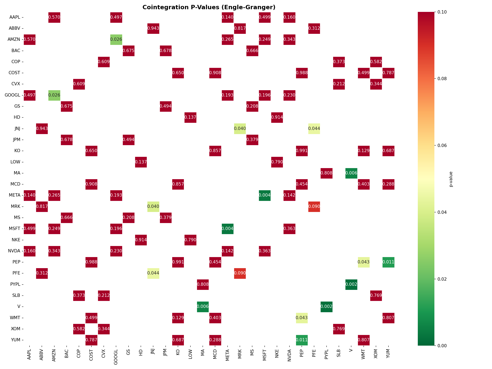
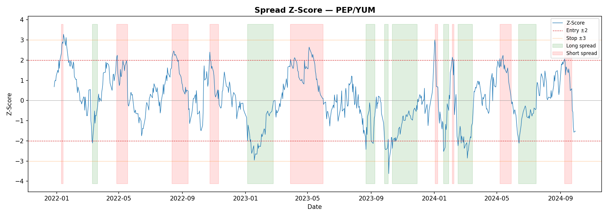
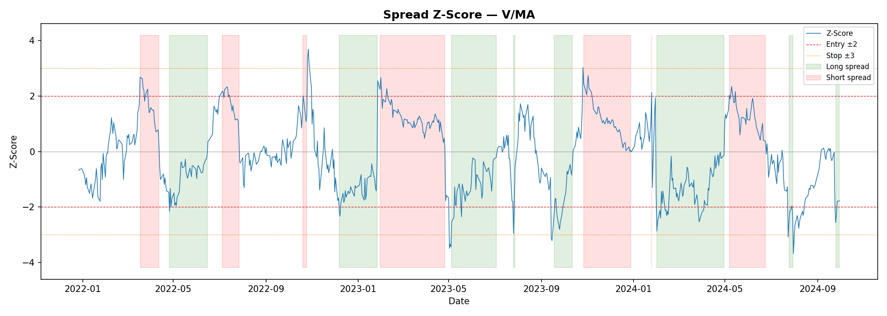
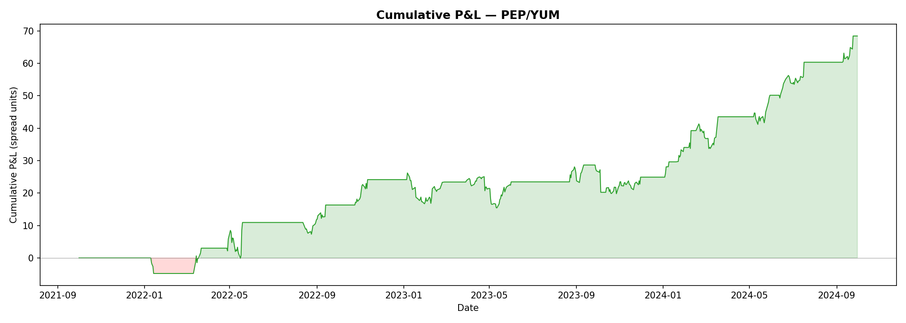
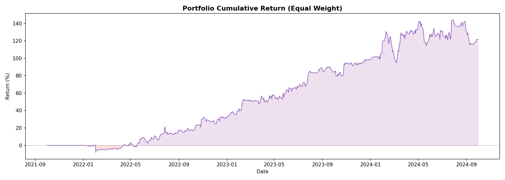

# Equity Pairs Trading Infrastructure


A Python pipeline for statistical arbitrage — ingests end-of-day equity data, tests for cointegration between stock pairs, generates z-score trading signals, and backtests the strategy. Built with a medallion architecture and automated data quality monitoring.

## Architecture

```
data/raw/           →    data/processed/        →    data/output/
(per-ticker OHLCV)       (reconciliation,            (backtest results,
                          cointegration,              charts, quality
                          signals)                    reports)
```

```
ingest.py → reconcile.py → cointegration.py → signals.py → backtest.py → report.py
                │
                └→ monitor.py (7 data quality checks → quality_report.json)
```

**Modules:**

- `src/ingest.py` — Dual-source ingestion (yfinance primary, Alpha Vantage secondary), per-ticker Parquet output
- `src/reconcile.py` — Cross-source alignment, divergence flagging, missing-day detection
- `src/cointegration.py` — Engle-Granger test on all within-sector pairs, OLS hedge ratios, OU half-life, Benjamini-Hochberg FDR correction
- `src/signals.py` — Spread z-score computation with entry/exit/stop-loss state machine
- `src/backtest.py` — Strategy simulation, Sharpe/drawdown/win rate, equal-weight portfolio aggregation
- `src/oos_validation.py` — Out-of-sample validation with train/test split
- `src/monitor.py` — 7 automated data quality checks (staleness, coverage, schema, outliers, zero volume, divergence drift, price sanity)

## Methodology

**Cointegration (Engle-Granger):** For each within-sector pair, regress price A on price B via OLS to get the hedge ratio β, then test whether the residuals are stationary using an augmented Dickey-Fuller test. After testing all 54 pairs, apply Benjamini-Hochberg FDR correction to control false discovery rate.

**Signal generation:** Compute the spread as `price_A - β · price_B`, then standardize with a 60-day rolling z-score. Enter long at z < −2, enter short at z > +2, exit on z-score sign reversal, stop-loss at |z| > 3.

**Backtesting:** Simulate daily P&L as `position × spread_change`, compute annualized Sharpe (√252), max drawdown, and win rate. Aggregate across pairs into an equal-weight portfolio.

**Out-of-sample validation:** Split at October 2023 — 2 years training, 1 year test. Re-run cointegration on training data only, apply training-period parameters to the test period without re-estimation.

## Results

### Cointegration Heatmap



*Engle-Granger p-values for all within-sector pairs. Green cells indicate raw significance (p < 0.05). After BH-FDR correction, no pairs remain significant.*

### Spread Z-Score — Top Pairs



*PEP/YUM spread z-score (Sharpe 1.56) with entry (±2) and stop-loss (±3) thresholds.*



*V/MA spread z-score (Sharpe 1.04).*

### P&L Curves



*PEP/YUM cumulative P&L — 122% total return.*



*Equal-weight portfolio across 9 raw-significant pairs.*

### Backtest Summary

| Pair | Total Return % | Sharpe | Max DD % | Trades | Win Rate % |
|------|---------------|--------|----------|--------|------------|
| PEP/YUM | 122.1 | 1.56 | -13.0 | 17 | 64.7 |
| PEP/COST | 42.0 | 1.06 | -15.2 | 16 | 68.8 |
| V/MA | 354.0 | 1.04 | -47.0 | 15 | 73.3 |
| PEP/WMT | 37.3 | 1.00 | -14.9 | 13 | 69.2 |
| PEP/MCD | 55.9 | 0.88 | -19.7 | 16 | 75.0 |
| MSFT/META | 50.7 | 0.64 | -23.8 | 12 | 50.0 |
| GOOGL/AMZN | 36.0 | 0.55 | -62.0 | 15 | 46.7 |
| JNJ/MRK | 17.4 | 0.54 | -11.2 | 14 | 42.9 |
| JNJ/PFE | 11.2 | 0.38 | -13.7 | 13 | 30.8 |
| **Portfolio (EW)** | **102.7** | **1.75** | **-11.0** | **131** | **57.9** |

9 of 54 pairs showed raw significance at p < 0.05. After FDR correction, 0 survived. Out-of-sample Sharpe degraded from 1.44 (in-sample) to 0.15 — the in-sample edge does not hold up under standard statistical rigor.

## Data

| Source | Role | Coverage |
|--------|------|----------|
| yfinance | Primary | 30 tickers × 3 years daily OHLCV |
| Alpha Vantage | Secondary (reconciliation) | Same tickers, free API |

**Universe:** 30 S&P 500 constituents across 7 sectors:

| Sector | Tickers | Pairs |
|--------|---------|-------|
| Tech | AAPL, MSFT, GOOGL, AMZN, NVDA, META | 15 |
| Consumer | KO, PEP, MCD, YUM, COST, WMT | 15 |
| Financials | JPM, BAC, GS, MS | 6 |
| Energy | XOM, CVX, COP, SLB | 6 |
| Healthcare | JNJ, PFE, MRK, ABBV | 6 |
| Payments | V, MA, PYPL | 3 |
| Retail | HD, LOW, NKE | 3 |

**Window:** October 2021 – September 2024 (753 NYSE trading days).

## Usage

```bash
git clone https://github.com/Minhal12345/equity-pairs-pipeline.git
cd equity-pairs-pipeline
pip install -r requirements.txt

# Run full pipeline
python main.py --skip-av

# Run with Alpha Vantage reconciliation
export ALPHAVANTAGE_API_KEY=your_key
python main.py --av-key $ALPHAVANTAGE_API_KEY

# Out-of-sample validation
python src/oos_validation.py

# Tests
pytest tests/ -v
```

## Tech Stack

Python, pandas, NumPy, statsmodels, matplotlib, Apache Parquet, pytest, GitHub Actions CI.
